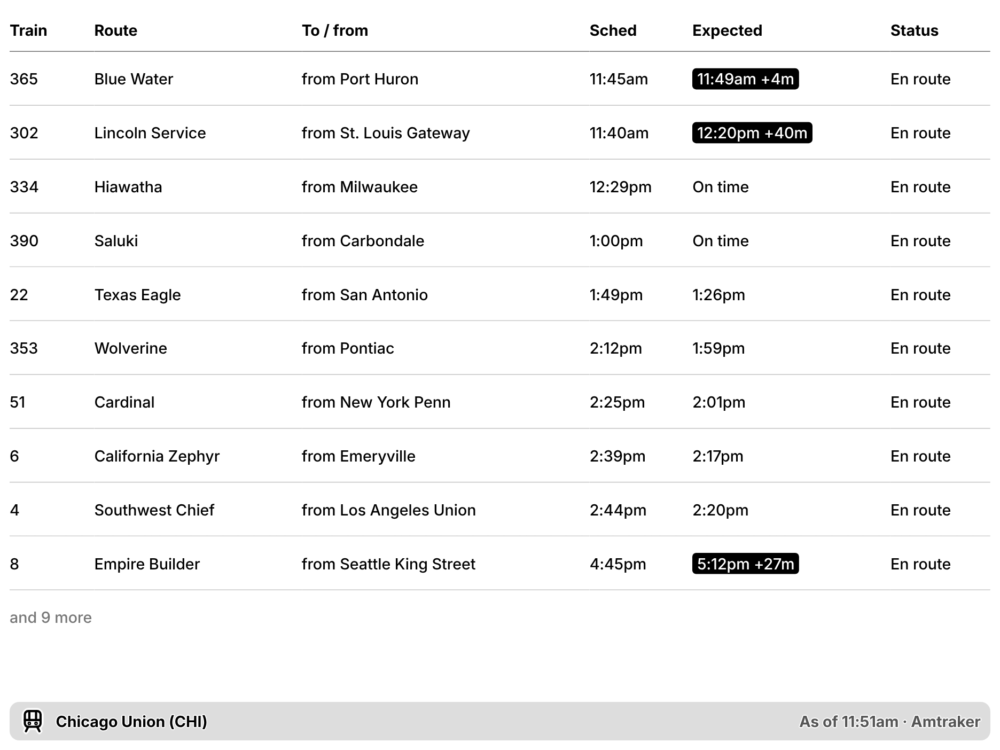

# Amtrak Station Board

Upcoming Amtrak trains at any station you choose, with scheduled and expected times and how late each train is. Data comes from [Amtraker](https://amtraker.com), an unofficial community API built on Amtrak's public train map.

More previews: [TRMNL OG](previews/og-full-local.png), [TRMNL OG 2-bit (Ann Arbor)](previews/og-2bit-ann-arbor-full-local.png), [TRMNL X portrait](previews/trmnl-x-portrait-full-local.png), and the half and quadrant layouts in [previews/](previews/).

## Settings
- **Station code**: the 3-letter Amtrak code, for example ARB (Ann Arbor), CHI (Chicago Union) or NYP (New York Penn). Defaults to ARB.
- **Recently departed trains**: 0 to 3 trains that left in the last 3 hours, shown grayed under the upcoming ones.
- **Time format**: 12-hour or 24-hour.
- **Thruway buses**: a switch to include Amtrak Thruway bus connections. Off by default.

## How it works
- TRMNL polls `https://api-v3.amtraker.com/v3/stations/{CODE}`, which lists the trains currently tracked at that station. There's no server, cron job or key.
- `transform.js` (serverless Node) fetches `/v3/trains` once (about 1.3 MB) and keeps this station's stop for each listed train.
- Departure times are used, except where a train ends at this station (arrival times, shown as "from" its origin). Times are as Amtraker reports them for the stop, in the station's local time. Delay is the estimate minus the schedule. Refresh floor is 15 minutes.

## Limits
- The station list only holds trains Amtrak is tracking right now (running, or about to leave their first station). It isn't a timetable, so a quiet station is empty overnight and later trains appear closer to their time. The screen says so when it's empty.
- Early estimates at intermediate stops show as "On time"; early arrivals at a terminal show the earlier time.
- Amtraker is unofficial, has no published rate limit, and could change without notice. An unknown station code shows an error screen.

## Layouts
- **full**: table of Train, Route, To / from, Sched, Expected and Status; the framework adds "and N more" when it overflows.
- **half_horizontal**: the same table without Status.
- **half_vertical**: 6 trains on the TRMNL OG, 9 on the TRMNL X in landscape, 12 in portrait.
- **quadrant**: the next 2 trains on the OG, 5 on the X in landscape, 7 in portrait.

Unofficial; not affiliated with Amtrak or Amtraker.
