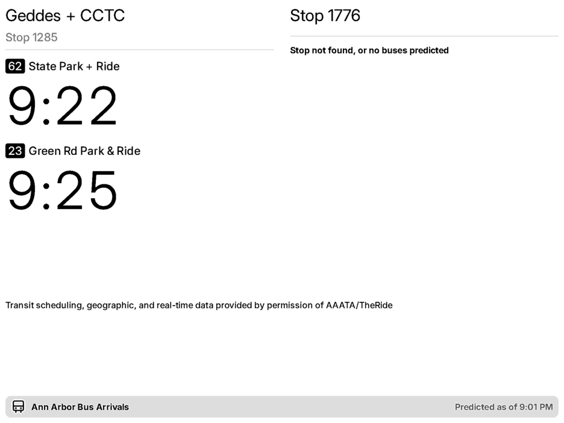

# Ann Arbor Bus Arrivals

Real-time bus arrival predictions for up to four AAATA (TheRide) stops in Ann Arbor and Ypsilanti. Arrivals are shown as clock times, along with the time the prediction was made, because the screen can lag the feed by up to one refresh.

## Settings
- **Stop IDs**: one to four TheRide stop numbers, separated by commas (for example `1285, 1776`). Use the stop number TheRide shows for real-time arrivals. It's the GTFS `stop_code`, which is not the same as `stop_id`. The full screen shows up to four stops; halves and quadrants show two.

## How it works
- TRMNL polls TheRide's BusTime predictions endpoint for all stops in one request. There's no server or cron job.
- `transform.js` groups predictions by stop and route. Stop names and directions come from the feed.
- Refresh floor is 15 minutes, to keep load on TheRide low.

## Data and terms
Transit scheduling, geographic, and real-time data provided by permission of AAATA/TheRide. That legend appears on every layout, as TheRide's [developer terms](https://www.theride.org/business/software-developers) require. The plugin uses a generic bus icon and no TheRide logos or marks. The polling endpoint is the one TheRide's own website uses. It isn't documented as a public API and could change.

Unofficial; not affiliated with or endorsed by AAATA.
