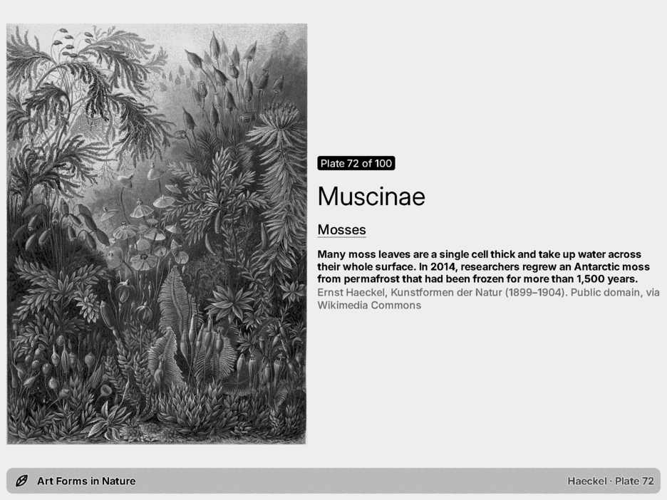

# Art Forms in Nature

One plate from Ernst Haeckel's *Kunstformen der Natur* (Art Forms in Nature, published in parts 1899 to 1904), with its plate number, the group it shows and a short natural history note. Ten plates rotate: jellyfish, sea anemones, radiolarians, siphonophores, hummingbirds, orchids, sea squirts, mosses, turtles and lichens.

## Settings
- **Rotation**: a new plate every day (default) or every hour.

## How it works
- A static plugin: no polling, key or account. The plate list lives in `shared.liquid`.
- Images are public-domain scans loaded from Wikimedia Commons through `Special:FilePath`, and TRMNL dithers them for e-ink.
- Plate numbers were checked against each Commons file page. Haeckel's plates carry no scale, so none is shown.

## Sources for the notes
The notes describe the organisms, not the plates, and were checked against these sources:
- Nematocyst discharge in about 700 ns (in *Hydra*): Nüchter et al. 2006, *Curr Biol* 16:R316. PMID 16682335
- Antarctic moss regrowing after more than 1,500 years frozen: Roads et al. 2014, *Curr Biol* 24:R222. PMID 24650904
- *Xanthoria elegans* surviving 18 months in open space (EXPOSE-E, ISS): Brandt et al. 2015, *Int J Astrobiol* 14:411. doi:10.1017/S1473550414000214
- Tunicates as the sister group of vertebrates: Delsuc et al. 2006, *Nature* 439:965. PMID 16495997
- Hummingbirds drawn from millinery specimens: Commons file description for `Haeckel_Trochilidae.jpg`

Unofficial; not affiliated with Wikimedia.
