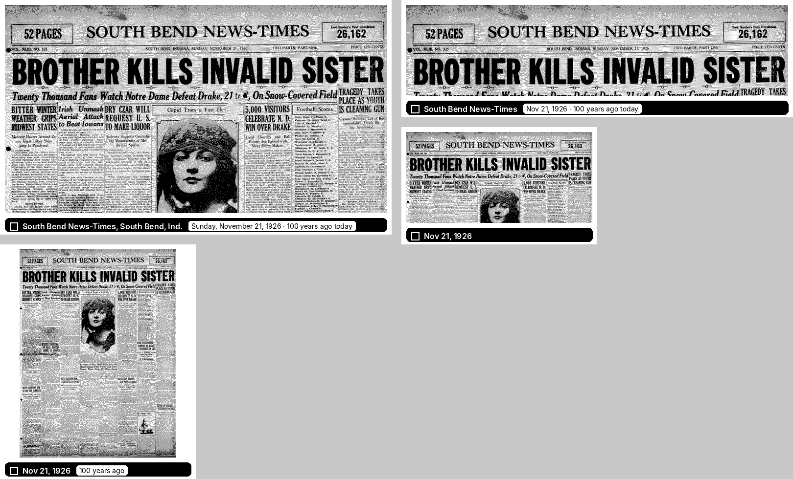

# 100 Years Ago Today

The front page of a newspaper printed 100 years ago today, from [Chronicling America](https://www.loc.gov/collections/chronicling-america/) at the Library of Congress. Landscape layouts show the masthead and top headlines; the half vertical layout shows the whole page.

Previews are local mock-ups (4-gray dither), not TRMNL renders.

## Settings
- **Newspaper**: one of nine dailies with scans for most days of 1926-1931. Default: *South Bend News-Times* (South Bend, Ind.). Chronicling America has no digitized Michigan papers for 1926 apart from one Finnish-language weekly, so the default is the nearest daily just over the Michigan line.

| Paper | LCCN | Issues indexed, 1926-1931 |
|---|---|---|
| South Bend News-Times (South Bend, Ind.) | sn87055779 | 2,094 |
| The Indianapolis Times (Indianapolis, Ind.) | sn82015313 | 1,875 |
| Evening Star (Washington, D.C.) | sn83045462 | 2,191 |
| The Washington Times (Washington, D.C.) | sn84026749 | 1,856 |
| The Washington Daily News (Washington, D.C.) | sn82016181 | 1,844 |
| New Britain Herald (New Britain, Conn.) | sn82014519 | 1,535 (none for 1931) |
| The Milwaukee Leader (Milwaukee, Wis.) | sn83045293 | 1,853 |
| The Bismarck Tribune (Bismarck, N.D.) | sn85042243 | 1,845 |
| Brownsville Herald (Brownsville, Tex.) | sn86063730 | 2,038 |

## How it works
- loc.gov's search API refuses requests from TRMNL's servers (HTTP 403), but page images on tile.loc.gov load fine. So `index/<lccn>/<year>.json` maps each issue date to the IIIF image service of that issue's front page and the page's width/height ratio. `build_index.py` made these files from the loc.gov API, one request per paper per year.
- TRMNL polls this year's index file from this repository (`polling_url.liquid`). `transform.js` works out today's date in your time zone minus 100 years, picks that day's issue, and builds IIIF crops of the front page.
- No issue that day (no Sunday edition, or a gap in the scans)? It shows the nearest issue and labels it "Nearest issue to <date>". Near New Year it also checks the neighbouring year's file.
- The index covers 1926-1931. After 2031 it will show the nearest indexed issue, labelled with how far off it is, until the index is extended.

## What's on screen
The page is the original scan, cropped but not edited. The paper's name, place and issue date come from the Library of Congress record; the weekday is calculated from the date. Nothing is summarised or rewritten.

Chronicling America pages are digitized by the National Digital Newspaper Program. Each loc.gov item record says that US newspapers published more than 95 years ago are in the public domain in their entirety, and that the Library believes the rest of the collection is public domain or has no known copyright restrictions ([Library of Congress legal notices](https://www.loc.gov/homepage/legal.html)). Unofficial; not affiliated with the Library of Congress.
