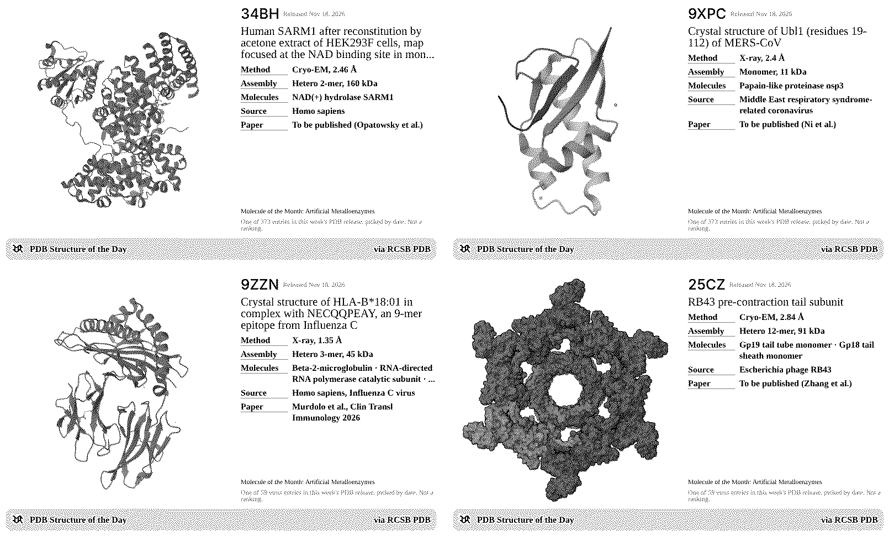

# PDB Structure of the Day

One structure a day from the latest weekly release of the Protein Data Bank, with RCSB PDB's image, title, method, resolution, assembly, molecules, source organisms and citation. Optionally shows the current PDB-101 Molecule of the Month as a footer.

## How the entry is chosen
RCSB doesn't publish a "structure of the day". This plugin takes the entries released in the past week (the PDB releases every Wednesday), sorts them by ID, and picks one using a fixed stride by day number, so consecutive days land on unrelated entries. It isn't a ranking or an editorial pick, and the footer says so. All text is RCSB's data for that entry.

## Settings
- **Structures**: all new structures, or virus structures only. "Virus only" keeps entries with at least one molecule from a virus (NCBI taxonomy), including antibody or receptor complexes with a viral protein.
- **Paper**: any, or only entries with a published paper. Many entries are released before their paper ("To be published").
- **Molecule of the Month**: show or hide the footer.

## How it works
- Polls the RCSB Search API for the week's IDs and, optionally, the PDB-101 Molecule of the Month RSS feed.
- `transform.js` (serverless Node) picks the ID, then makes one RCSB Data API (GraphQL) request for that entry and checks that the image exists.
- Images: `cdn.rcsb.org/images/structures/pdb/{id}_assembly-1.jpeg`, falling back to `_model-1`.
- No key, server or cron job. Refresh floor is 240 minutes.

## Quirks
- The assembly label is RCSB's computed oligomeric state, so a single entity with two chains can read "Hetero 2-mer".
- If nothing matches, the Search API returns HTTP 204 and the screen says there are no new entries.

Data and images from [RCSB PDB](https://www.rcsb.org). Unofficial; not affiliated with RCSB PDB or wwPDB.
