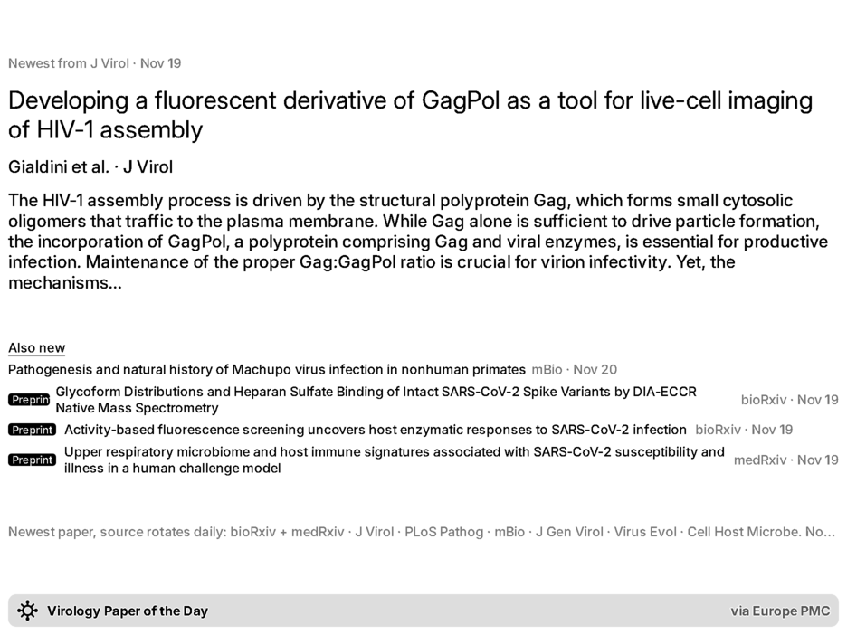

# Virology Paper of the Day

One new virology paper a day from bioRxiv preprints and peer-reviewed journals. The featured paper is the newest matching paper from one source, and the source rotates each day. It isn't a ranking of importance, and the footer says so. Preprints are labelled "not peer reviewed".

## Settings
- **Preprints**: bioRxiv (default), bioRxiv and medRxiv, or none. Stored values are `biorxiv`, `biorxiv_medrxiv` and `none`; older installs that saved the display text still work.
- **Journals (ISSN)**: up to six. Defaults are J Virol, PLOS Pathogens, mBio, J Gen Virol, Virus Evolution and Cell Host & Microbe.
- **Topic words**: a paper must mention one of these in its title or abstract (preprints: in the title).
- **Look back**: 7, 14 or 30 days (default 30, because some journals are indexed by monthly issue date).

## How it works
- One Europe PMC REST search per source, polled directly by TRMNL. No key, server or cron job. Refresh floor is 240 minutes.
- bioRxiv covers all of biology and has no virology category, so preprints must have a topic word in the title. Matching is word-aware, so "phage" doesn't match "macrophage".
- If today's source has nothing new, the next source with papers is used, and the screen says so.
- Errata and retraction notices are excluded.
- Each response is matched to its source by the query Europe PMC echoes back, so the daily rotation doesn't shift when one request fails.
- If some sources don't answer (Europe PMC sometimes returns 500 or 503), the screen shows one short line naming them and uses the rest. If none answer, it says "Europe PMC did not respond. Trying again at the next refresh." instead of an empty screen.

## Layouts
- All four layouts scale up on the TRMNL X (`lg:` title and abstract sizes, more clamped lines).
- On the TRMNL X in portrait, the quadrant also shows an abstract excerpt and the half layouts show longer ones.

## Why not "most notable"?
There's no honest free signal for brand-new papers. Altmetric's API has needed a key since November 2025, and citation counts are zero for new papers.

## Limits
- Europe PMC can be slow (some queries took 9 to 14 seconds in testing) and indexes bioRxiv about a day after posting.
- The topic-word filter is crude: a journal abstract that mentions a virus in passing will pass.
- Short abstract excerpts come from Europe PMC; abstracts belong to their authors and publishers.

Data from [Europe PMC](https://europepmc.org). Unofficial; not affiliated with Europe PMC, bioRxiv, ASM or PLOS.
