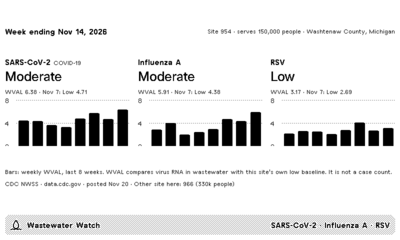

# Wastewater Watch

Weekly SARS-CoV-2, influenza A and RSV levels in wastewater from one sewage treatment site, from CDC's National Wastewater Surveillance System (NWSS). Shows CDC's Wastewater Viral Activity Level (WVAL) and category (Very Low to Very High), the data week, the population the site serves, and the last 8 weeks.

## Settings
- **State or territory** and **County**: where to look for treatment sites.
- **Site number** (optional): CDC numbers sites anonymously. Leave blank to use the site with the newest data that serves the most people. The screen lists the other site numbers in your county.

## How it works
- TRMNL polls the keyless Socrata dataset [`atcp-73re`](https://data.cdc.gov/resource/atcp-73re.json) on data.cdc.gov. There's no server or cron job.
- `transform.js` (serverless Node) picks the site, then builds the current levels and the 8-week history.
- CDC updates the dataset on Fridays, and `week_end` is a Saturday. Refresh floor is 240 minutes.

## What the numbers mean
WVAL compares a site's virus RNA level with that site's own low baseline over the past 2 years ([CDC method](https://www.cdc.gov/wastewater/about/wval.html)). It isn't a case count.

- Values and categories are shown exactly as CDC publishes them. Nothing is smoothed, interpolated or recalculated.
- Data more than 14 days old is labelled with its age. Missing data shows as an empty state, never as zero.
- WVAL values aren't comparable across viruses, because each virus has its own category cut points. Compare categories, not bar heights.
- Influenza A RNA in wastewater can come from non-human sources (for example H5 from animal or milk waste), so a rise in flu A isn't necessarily human flu.
- Two sites in the same county can disagree a lot. They serve different sewersheds.

Unofficial; not affiliated with CDC.
